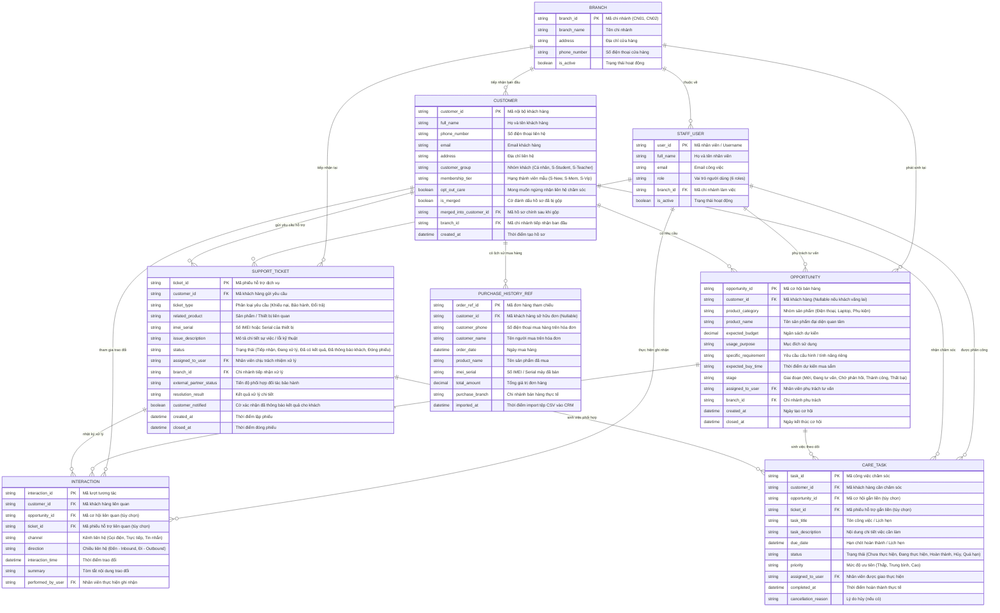

# SẢN PHẨM BÀN GIAO D01: SƠ ĐỒ ERD LOGIC & THUYẾT MINH QUAN HỆ
## HỆ THỐNG CRM CHUỖI BÁN LẺ CELLPHONES (TRÊN NỀN TẢNG FRAPPE FRAMEWORK)

**Mã sản phẩm:** D01  
**Tên sản phẩm:** Sơ đồ ERD Logic & Thuyết minh quan hệ  
**Người thực hiện:** Trần Quang Huy (MSSV: 24520706 – TV4)  
**Vai trò:** Quản trị hệ thống, Phụ trách Mô hình Dữ liệu và Thiết kế Triển khai  
**Nền tảng mục tiêu:** Frappe Framework v15 (Custom App độc lập `cellphones_crm`)  
**Tài liệu cơ sở:**
- `Nền Tảng CRM.md` (Nền tảng phân tích hệ thống CRM CellphoneS)
- `Nhiemvu.md` (Phân công nhiệm vụ và yêu cầu chuẩn đầu ra TV4)
- *Software Requirements Essentials* (Karl Wiegers, Candase Hokanson) – 5 Thực hành cốt lõi Chương 2: Laying the Foundation  
**Trạng thái:** Hoàn thiện (Thiết kế đề xuất – Proposed Design)

---

## 1. TỔNG QUAN PHẠM VI DỮ LIỆU & GẮN KẾT VỚI 5 THỰC HÀNH CHƯƠNG 2

Sản phẩm **D01 (ERD Logic)** được xây dựng nhằm thiết lập nền tảng cấu trúc dữ liệu chuẩn cho phân hệ CRM CellphoneS mô phỏng hoạt động tại 2 chi nhánh, bám sát 5 thực hành cốt lõi của Karl Wiegers & Candase Hokanson:

1. **Practice #1 – Hiểu đúng vấn đề trước khi thiết kế giải pháp (Understand the problem before converging on a solution):**
   - Cấu trúc thực thể tập trung giải quyết triệt để 3 bài toán nghiệp vụ cốt lõi:
     - *Thông tin khách hàng và nhu cầu bị phân tán*: Giải quyết bằng mô hình `Customer` tập trung liên kết với `Opportunity` (lưu từng nhu cầu riêng biệt, không ghi đè nhu cầu cũ).
     - *Bỏ sót công việc chăm sóc khách hàng*: Giải quyết bằng thực thể `Care_Task` có thời hạn (`due_date`), trạng thái và nhân viên phụ trách (`assigned_to_user`).
     - *Mất dấu vết và thiếu người chịu trách nhiệm trong xử lý hậu mãi*: Giải quyết bằng thực thể `Support_Ticket` có trạng thái, phân công người xử lý (`assigned_to_user`), kết quả xử lý (`resolution_result`) và cờ xác nhận đã thông báo khách hàng (`customer_notified`).
   - *Ranh giới rành mạch*: Không đưa vào các thực thể nằm ngoài phạm vi như kho hàng chi tiết, thanh toán kế toán, hay quy trình sửa chữa linh kiện phần cứng nội bộ.

2. **Practice #2 – Xác định mục tiêu kinh doanh & chỉ tiêu thành công (Define business objectives):**
   - Thiết kế các trường dữ liệu hỗ trợ trực tiếp việc đo lường 3 chỉ tiêu thành công:
     - *Chỉ tiêu 1 (Tiếp nối tư vấn $\ge 18/20$ ca)*: Cung cấp đầy đủ lịch sử nhu cầu (`Opportunity`), lịch sử trao đổi (`Interaction`) và ghi chú chăm sóc (`Care_Task`).
     - *Chỉ tiêu 2 (Hoàn thành chăm sóc đúng hạn $\ge 90\%$)*: Cung cấp trường `due_date`, `completed_at`, `status` trong `Care_Task` để tính toán tỷ lệ hoàn thành đúng hạn trong đợt thử nghiệm.
     - *Chỉ tiêu 3 (100% phiếu hỗ trợ có trách nhiệm và kết quả)*: Ràng buộc bắt buộc `assigned_to_user` trên các phiếu đang mở và bắt buộc có `resolution_result`, `customer_notified` khi đóng phiếu `Support_Ticket`.

3. **Practice #3 – Xác định ranh giới giải pháp & tự động hóa (Define the solution's boundaries):**
   - Phân định rõ dữ liệu nội bộ CRM và dữ liệu ngoài tham chiếu: Dữ liệu mua hàng từ POS/ERP được nhập mẫu qua CSV vào thực thể `Purchase_History_Ref` chỉ để tra cứu tham chiếu (read-only), không chỉnh sửa.
   - Ranh giới tự động hóa: Nhân viên ghi nhận thực tế, hệ thống tự động kiểm tra tính hợp lệ dữ liệu, nhắc việc đến hạn và phân quyền theo chi nhánh.

4. **Practice #4 – Phân loại bên liên quan & người dùng (Identify and characterize stakeholders):**
   - Thực thể `Staff_User` phân định rõ 6 vai trò: Nhân viên bán hàng, CSKH cửa hàng, Quản lý cửa hàng, CSKH cấp chuỗi, Quản lý cấp chuỗi, Quản trị hệ thống.

5. **Practice #5 – Người ra quyết định & quy tắc quyết định (Identify empowered decision makers):**
   - Toàn bộ thiết kế mang nhãn **Proposed Design (Thiết kế đề xuất)**, sẵn sàng điều chỉnh theo quyết định thống nhất của nhóm.
   - Xây dựng quy tắc gộp hồ sơ trùng có kiểm soát (Merge Rule) dành riêng cho cấp quản trị.

---

## 2. SƠ ĐỒ ERD LOGIC HỆ THỐNG CRM CELLPHONES

Dưới đây là sơ đồ quan hệ thực thể logic (ERD) thể hiện đầy đủ 8 thực thể, khóa chính (PK), khóa ngoại (FK), các thuộc tính đặc trưng và bản số quan hệ (Cardinality):

---

## 3. THUYẾT MINH QUAN HỆ & BỘI SỐ (CARDINALITY)

### 3.1. Nhóm Quản lý Tổ chức & Nhân sự (`Branch` – `Staff_User`)
* **`Branch` (1) – (N) `Staff_User`**: 
  - *Ý nghĩa*: Mỗi nhân viên thuộc về một chi nhánh cửa hàng cụ thể (hoặc thuộc văn phòng chuỗi đối với vai trò cấp chuỗi).
  - *Bội số*: Một chi nhánh có $1..N$ nhân viên; một nhân viên bắt buộc thuộc về $1..1$ chi nhánh.
  - *Ràng buộc phân quyền*: Phục vụ thiết lập `User Permission` trên Frappe để nhân viên chỉ thấy dữ liệu của chi nhánh mình.

### 3.2. Nhóm Hồ sơ Khách hàng 360° (`Customer`)
* **`Customer` (1) – (N) `Opportunity`**:
  - *Ý nghĩa*: Một khách hàng có thể có nhiều nhu cầu mua sắm tại các thời điểm khác nhau. Hệ thống lưu từng bản ghi `Opportunity` riêng biệt, không ghi đè nhu cầu cũ bằng nhu cầu mới.
  - *Bội số*: Một khách hàng có $0..N$ cơ hội tư vấn; một cơ hội tư vấn thuộc về $0..1$ khách hàng (Nullable trong trường hợp khách vãng lai ban đầu).
* **`Customer` (1) – (N) `Interaction`**:
  - *Ý nghĩa*: Toàn bộ lịch sử các lần trao đổi (gọi điện, gặp tại quầy, nhắn tin) đều được gắn chặt với hồ sơ khách hàng.
  - *Bội số*: Một khách hàng có $0..N$ lượt tương tác; một lượt tương tác thuộc về $0..1$ khách hàng.
* **`Customer` (1) – (N) `Care_Task`**:
  - *Ý nghĩa*: Các đầu việc chăm sóc hoặc lịch hẹn gọi lại cho khách hàng.
  - *Bội số*: Một khách hàng có $0..N$ công việc chăm sóc; mỗi công việc gắn với $1..1$ khách hàng.
* **`Customer` (1) – (N) `Support_Ticket`**:
  - *Ý nghĩa*: Lịch sử tiếp nhận phản ánh, khiếu nại, bảo hành, đổi trả của khách hàng.
  - *Bội số*: Một khách hàng có $0..N$ phiếu hỗ trợ; mỗi phiếu bắt buộc thuộc về $1..1$ khách hàng.
* **`Customer` (1) – (N) `Purchase_History_Ref`**:
  - *Ý nghĩa*: Lịch sử mua sắm từ dữ liệu mẫu CSV để nhân viên tra cứu điều kiện bảo hành, chính sách ưu đãi khi tư vấn.
  - *Bội số*: Một khách hàng có thể liên kết với $0..N$ đơn hàng tham chiếu dựa trên số điện thoại hoặc mã khách hàng.

### 3.3. Nhóm Nghiệp vụ Bán hàng & Tư vấn (`Opportunity`)
* **`Opportunity` (1) – (N) `Interaction`**:
  - *Ý nghĩa*: Các cuộc gọi và lần tư vấn trực tiếp phát sinh trong quá trình chốt một cơ hội cụ thể.
* **`Opportunity` (1) – (N) `Care_Task`**:
  - *Ý nghĩa*: Lịch hẹn gọi lại hoặc gửi báo giá cấu hình phát sinh từ cơ hội bán hàng.

### 3.4. Nhóm Nghiệp vụ Dịch vụ & Hậu mãi (`Support_Ticket`)
* **`Support_Ticket` (1) – (N) `Interaction`**:
  - *Ý nghĩa*: Nhật ký các lần trao đổi với khách để cập nhật tiến độ sửa chữa/bảo hành từ đối tác ngoài.
* **`Support_Ticket` (1) – (N) `Care_Task`**:
  - *Ý nghĩa*: Công việc giao cho nhân viên đi nhận máy từ đối tác bảo hành hoặc gọi thông báo khách đến nhận máy.

---

## 4. GIẢI PHÁP CHO 2 BÀI TOÁN KỸ THUẬT DỮ LIỆU ĐẶC THÙ

### 4.1. Bài toán 1: Tiếp nhận Khách vãng lai / Chưa định danh (Guest & Unidentified Customer)
* **Vấn đề thực tế**: Khách hàng gọi đến hotline hoặc bước vào cửa hàng hỏi thông tin nhanh nhưng chưa muốn để lại thông tin cá nhân đầy đủ hoặc nhân viên chưa kịp tạo hồ sơ.
* **Giải pháp thiết kế**:
  1. Trong thực thể `Opportunity` và `Interaction`, trường khóa ngoại `customer_id` được thiết lập ở chế độ **Nullable** (cho phép để trống).
  2. Bổ sung các trường tạm thời: `temp_customer_name`, `temp_phone_number` ngay trên form tiếp nhận tư vấn/tương tác.
  3. Khi khách hàng đồng ý cung cấp thông tin hoặc chuyển sang giai đoạn quan tâm sâu/mua sắm, nhân viên kích hoạt tính năng **"Tạo & Gán hồ sơ khách hàng"** trên Frappe UI. Hệ thống sẽ tự động tạo bản ghi `Customer` mới và cập nhật `customer_id` vào các cơ hội/tương tác trước đó, bảo toàn 100% ngữ cảnh tư vấn ban đầu.

### 4.2. Bài toán 2: Quản lý Trùng lặp & Quy tắc Gộp hồ sơ (Duplicate Detection & Merge Rule)
* **Vấn đề thực tế**: Khách hàng có thể được tạo nhiều hồ sơ do nhập sai định dạng SĐT, người thân dùng chung SĐT hoặc nhân viên ở 2 chi nhánh khác nhau cùng tạo mới.
* **Quy tắc xử lý đã chốt theo `Nền Tảng CRM.md`**:
  1. **Tuyệt đối không tự động gộp hồ sơ**: Số điện thoại là trường hỗ trợ tìm kiếm và cảnh báo trùng, không dùng làm khóa chính và không tự động gộp ngầm khi phát hiện trùng.
  2. **Cảnh báo trùng tại giao diện**: Khi nhân viên nhập `phone_number` đã tồn tại, hệ thống hiển thị thông báo: *"Số điện thoại này đã tồn tại trong hồ sơ KHxxxx - Bạn có muốn xem hồ sơ này không?"*.
  3. **Phân quyền thực hiện gộp**: Chỉ vai trò **Quản trị hệ thống (System Administrator)** hoặc **Quản lý cấp chuỗi (Chain Manager)** mới có quyền thực hiện thao tác Merge Customer.
  4. **Cơ chế lưu vết và bảo toàn dữ liệu khi gộp**:
     - Hồ sơ chính (Target Master): Giữ nguyên `customer_id`, cập nhật thông tin chuẩn nhất.
     - Hồ sơ phụ (Source Duplicate): Đặt cờ `is_merged = true`, gán `merged_into_customer_id = Master_customer_id`, trạng thái chuyển sang Không hoạt động (`is_active = false`).
     - Cập nhật toàn bộ khóa ngoại `customer_id` ở các bảng con (`Opportunity`, `Interaction`, `Care_Task`, `Support_Ticket`, `Purchase_History_Ref`) trỏ về `Master_customer_id`.
     - Lưu nhật ký gộp hồ sơ vào lịch sử hệ thống (`Version/Activity Log`), đảm bảo không làm mất bất kỳ thông tin phục vụ nào trước đó.

---

## 5. ĐÁNH GIÁ TÍNH THỐNG NHẤT & KHẢ NĂNG ĐÁP ỨNG MỤC TIÊU NGHIỆM THU

| Chỉ tiêu nghiệm thu (Tại Section 6 `Nền Tảng CRM.md`) | Thực thể & Trường dữ liệu hỗ trợ trong ERD | Cơ chế kiểm tra tính đáp ứng |
| :--- | :--- | :--- |
| **Tiếp nối tư vấn thuận lợi** ($\ge 18/20$ ca bàn giao đủ thông tin tiếp nối) | `CUSTOMER.customer_id` `OPPORTUNITY.usage_purpose, specific_requirement, stage` `INTERACTION.summary, interaction_time` `CARE_TASK.task_description` | Kiểm tra hồ sơ bàn giao có đầy đủ liên kết tới lần tư vấn gần nhất và công việc tiếp theo; phân quyền theo `Branch` giúp nhân viên nhận việc truy cập đúng thẩm quyền. |
| **Theo dõi chăm sóc đúng hẹn** ($\ge 90\%$ việc hoàn thành đúng hạn trong 2 tuần) | `CARE_TASK.due_date` `CARE_TASK.completed_at` `CARE_TASK.status` `CARE_TASK.cancellation_reason` | Truy vấn tỷ lệ: `COUNT(completed_at <= due_date) / COUNT(due_date in test_range)`. Các việc hủy có lý do được lọc riêng theo `status = 'Hủy'`. |
| **Trách nhiệm xử lý hậu mãi** ($100\%$ phiếu có người phụ trách, tiến độ & kết quả) | `SUPPORT_TICKET.assigned_to_user` `SUPPORT_TICKET.status` `SUPPORT_TICKET.resolution_result` `SUPPORT_TICKET.customer_notified` | Kiểm tra toàn bộ phiếu mở có `assigned_to_user NOT NULL`. Phiếu đóng bắt buộc có `resolution_result NOT NULL` và `customer_notified = TRUE`. |

---
*Bản tài liệu D01 này đã hoàn thiện đầy đủ các yêu cầu kỹ thuật và làm cơ sở trực tiếp để xây dựng Từ điển dữ liệu D02 và Ánh xạ Frappe D04.*
