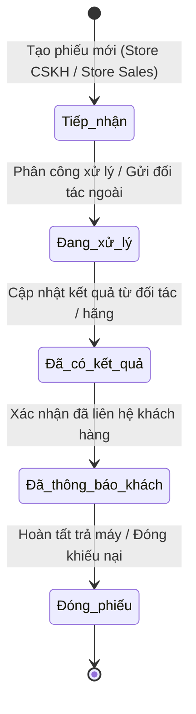

# SẢN PHẨM BÀN GIAO D04: BẢNG ÁNH XẠ THIẾT KẾ SANG FRAPPE FRAMEWORK
## HỆ THỐNG CRM CHUỖI BÁN LẺ CELLPHONES (TRÊN NỀN TẢNG FRAPPE FRAMEWORK)

**Mã sản phẩm:** D04  
**Tên sản phẩm:** Bảng ánh xạ thiết kế sang Frappe Framework (DocType Mapping & Implementation Architecture)  
**Người thực hiện:** Trần Quang Huy (MSSV: 24520706 – TV4)  
**Vai trò:** Quản trị hệ thống, Phụ trách Mô hình Dữ liệu và Thiết kế Triển khai  
**Nền tảng mục tiêu:** Frappe Framework v15 (Custom App độc lập `cellphones_crm` – Zero ERPNext Dependency)  
**Tài liệu cơ sở:**
- `Nền Tảng CRM.md` (Nền tảng phân tích hệ thống CRM CellphoneS)
- `Nhiemvu.md` (Phân công nhiệm vụ và yêu cầu chuẩn đầu ra TV4)
- `docs/D01_ERD_ThuyetMinh.md` & `docs/D02_TuDienDuLieu.md` (Mô hình ERD và Từ điển dữ liệu)  
**Trạng thái:** Hoàn thiện (Thiết kế đề xuất – Proposed Design)

---

## 1. TỔNG QUAN KIẾN TRÚC TRIỂN KHAI TRÊN FRAPPE FRAMEWORK V15

1. **Chiến lược Custom App độc lập (`cellphones_crm`):**
   * Hệ thống được xây dựng dưới dạng một **Frappe App độc lập** mang tên `cellphones_crm`, cài đặt trên nền tảng **Frappe Framework v15**.
   * **Nguyên tắc cốt lõi (Zero Dependency):** Không phụ thuộc vào ứng dụng cồng kềnh `ERPNext`. Toàn bộ các DocType nghiệp vụ đặc thù cho chuỗi bán lẻ công nghệ (như Cơ hội tư vấn theo thiết bị, Phiếu hỗ trợ bảo hành đối tác, Lịch sử mua hàng tham chiếu CSV) được thiết kế tối ưu, nhẹ và bám sát chính xác phạm vi đồ án.
2. **Khai thác các Module cốt lõi của Core Frappe:**
   * Tận dụng tối đa các thành phần chuẩn mạnh mẽ của Frappe: Hệ thống xác thực người dùng (`User`, `Role`), Phân quyền chi tiết (`Role Permission Manager`, `User Permission`), Quản lý quy trình (`Workflow`), Quản lý tài liệu nhập liệu (`Data Import`), Giao diện Desk tùy biến (`Workspace`, `Dashboard`, `Report Builder`).

---

## 2. BẢNG ÁNH XẠ THỰC THỂ SANG DOCTYPE (DOCTYPE MAPPING)

| STT | Thực thể ERD (D01) | Tên DocType Frappe dự kiến | Phân loại DocType | Kế thừa / Tự xây | Nguồn gốc & Mục đích sử dụng |
| :---: | :--- | :--- | :--- | :--- | :--- |
| **1** | `Branch` | `Branch` | Standard (Master) | Custom DocType | Quản lý danh mục 2 cửa hàng mô phỏng và trụ sở chuỗi để phân quyền. |
| **2** | `Staff_User` | `User` / `Staff Profile` | Standard (System) | Kế thừa Core `User` + Custom DocType `Staff Profile` | Quản lý tài khoản đăng nhập, gán Role và liên kết với `Branch`. |
| **3** | `Customer` | `CellphoneS Customer` | Standard (Master) | Custom DocType | Quản lý hồ sơ 360° khách hàng cá nhân, phân nhóm HSSV/GV và hạng Smember. |
| **4** | `Opportunity` | `CellphoneS Opportunity`| Standard (Submittable)| Custom DocType | Quản lý cơ hội bán hàng, nhu cầu theo 3 nhóm SP (Điện thoại, Laptop, Phụ kiện). |
| **5** | `Interaction` | `Customer Interaction` | Standard (Transaction)| Custom DocType | Nhật ký trao đổi đa kênh (gọi điện, tại quầy, tin nhắn) của nhân viên. |
| **6** | `Care_Task` | `Customer Care Task` | Standard (Transaction)| Custom DocType | Quản lý lịch hẹn, nhắc việc chăm sóc khách hàng và giám sát KPI đúng hạn. |
| **7** | `Support_Ticket`| `Support Ticket` | Standard (Submittable)| Custom DocType | Tiếp nhận và theo dõi xử lý khiếu nại, bảo hành, đổi trả liên chi nhánh. |
| **8** | `Purchase_History_Ref` | `Purchase History Ref` | Standard (Reference) | Custom DocType | Lưu trữ dữ liệu lịch sử mua hàng import từ tệp CSV phục vụ tra cứu. |

---

## 3. ÁNH XẠ CÁC LOẠI QUAN HỆ VÀ KIỂU TRƯỜNG TRÊN FRAPPE

1. **Quan hệ 1 - Nhiều (1 - N) $\rightarrow$ Sử dụng Trường kiểu `Link`:**
   * `CellphoneS Opportunity.customer_id` $\rightarrow$ `Link` trỏ đến `CellphoneS Customer`.
   * `CellphoneS Opportunity.assigned_to_user` $\rightarrow$ `Link` trỏ đến `User`.
   * `Support Ticket.branch_id` $\rightarrow$ `Link` trỏ đến `Branch`.
   * `Customer Care Task.assigned_to_user` $\rightarrow$ `Link` trỏ đến `User`.
2. **Quan hệ Tham chiếu Lịch sử $\rightarrow$ Sử dụng Trường kiểu `Link` kết hợp Filter:**
   * `Purchase History Ref.customer_id` $\rightarrow$ `Link` trỏ đến `CellphoneS Customer` (tìm kiếm theo SĐT hoặc mã KH).
3. **Danh sách liên kết trên Form chính $\rightarrow$ Sử dụng `Connections` (Dashboard View):**
   * Trên Form `CellphoneS Customer`, cấu hình mục `Connections` hiển thị các liên kết nhanh tới `CellphoneS Opportunity`, `Support Ticket`, `Customer Interaction`, `Customer Care Task`, `Purchase History Ref`.

---

## 4. THIẾT KẾ WORKFLOW & QUY TRÌNH CHUYỂN TRẠNG THÁI

### 4.1. Workflow: Phiếu Hỗ Trợ Dịch Vụ (`Support Ticket`)
* **DocType áp dụng:** `Support Ticket`
* **Trường theo dõi trạng thái:** `status`

* **Ma trận Transitions của Workflow `Support Ticket`:**

| Trạng thái hiện tại | Hành động (Action) | Trạng thái tiếp theo | Vai trò được phép (Allowed Roles) | Điều kiện kiểm tra ràng buộc (Conditions) |
| :--- | :--- | :--- | :--- | :--- |
| *Bắt đầu* | Tiếp nhận | `Tiếp nhận` | Store Sales, Store CSKH, Chain CSKH | Bắt buộc nhập `customer_id`, `issue_description`. |
| `Tiếp nhận` | Phân công xử lý | `Đang xử lý` | Store CSKH, Store Manager, Chain CSKH | Bắt buộc chọn `assigned_to_user`. |
| `Đang xử lý` | Cập nhật kết quả | `Đã có kết quả` | Store CSKH, Store Manager, Chain CSKH | Bắt buộc nhập `resolution_result`. |
| `Đã có kết quả` | Báo khách hàng | `Đã thông báo khách`| Store Sales, Store CSKH, Chain CSKH | Tích chọn `customer_notified = 1`. |
| `Đã thông báo khách` | Nghiệm thu & Đóng | `Đóng phiếu` | Store CSKH, Store Manager, Chain Manager | `resolution_result NOT NULL` và `customer_notified = 1`. |

---

### 4.2. Workflow: Cơ Hội Bán Hàng & Tư Vấn (`CellphoneS Opportunity`)
* **DocType áp dụng:** `CellphoneS Opportunity`
* **Trường theo dõi giai đoạn:** `stage`

| Trạng thái hiện tại | Hành động (Action) | Trạng thái tiếp theo | Vai trò được phép (Allowed Roles) | Điều kiện kiểm tra ràng buộc (Conditions) |
| :--- | :--- | :--- | :--- | :--- |
| *Bắt đầu* | Tạo cơ hội | `Mới tiếp nhận` | Store Sales, Store CSKH, Chain CSKH | Bắt buộc chọn `product_category`, `product_name`. |
| `Mới tiếp nhận` | Bắt đầu tư vấn | `Đang tư vấn` | Store Sales, Chain CSKH | Bắt buộc chọn `assigned_to_user`. |
| `Đang tư vấn` | Gửi báo giá/Hẹn | `Chờ phản hồi` | Store Sales, Chain CSKH | Tự động tạo `Customer Care Task` nhắc hẹn. |
| `Đang tư vấn` / `Chờ phản hồi` | Chốt đơn | `Thành công` | Store Sales, Store Manager, Chain CSKH | Ghi nhận hoàn tất tư vấn. |
| `Đang tư vấn` / `Chờ phản hồi` | Báo mất khách | `Thất bại` | Store Sales, Store Manager | Bắt buộc nhập `lost_reason`. |
| Mọi trạng thái | Hủy nhu cầu | `Hủy` | Store Sales, Store Manager, Chain Manager | Bắt buộc nhập `lost_reason`. |

---

## 5. MA TRẬN PHÂN QUYỀN VAI TRÒ (ROLE PERMISSION MANAGER)

Hệ thống thiết lập phân quyền chặt chẽ cho 6 nhóm vai trò người dùng:

| DocType | Store Sales (Bán hàng CH) | Store CSKH (CSKH CH) | Store Manager (Quản lý CH) | Chain CSKH (CSKH Chuỗi) | Chain Manager (Quản lý Chuỗi) | System Administrator (Quản trị hệ thống) |
| :--- | :---: | :---: | :---: | :---: | :---: | :---: |
| **`Branch`** | Read | Read | Read | Read | Read, Write | All (R, W, C, D) |
| **`CellphoneS Customer`** | Read, Write, Create | Read, Write, Create | Read, Write, Create | Read, Write, Create | Read, Write, Create | All (Bao gồm quyền Gộp hồ sơ) |
| **`CellphoneS Opportunity`**| R, W, C (Theo Chi nhánh)| R, W, C (Theo Chi nhánh)| R, W, C, Delete (Chi nhánh)| R, W, C (Toàn chuỗi) | Read, Write, Export (Toàn chuỗi)| All |
| **`Customer Interaction`** | R, W, C (Tự tạo) | R, W, C (Chi nhánh) | R, W, C (Chi nhánh) | R, W, C (Toàn chuỗi) | Read, Export (Toàn chuỗi) | All |
| **`Customer Care Task`** | R, W, C (Được giao) | R, W, C (Chi nhánh) | R, W, C, Assign (Chi nhánh)| R, W, C (Toàn chuỗi) | Read, Export (Toàn chuỗi) | All |
| **`Support Ticket`** | Read, Create | R, W, C, Submit (Chi nhánh)| R, W, C, Submit (Chi nhánh)| R, W, C, Submit (Toàn chuỗi)| Read, Write, Export (Toàn chuỗi)| All |
| **`Purchase History Ref`**| Read (Tra cứu) | Read (Tra cứu) | Read (Tra cứu) | Read (Tra cứu) | Read, Export | All (Bao gồm quyền Import CSV) |

### Cơ chế Giới hạn Phạm vi Chi nhánh (`User Permission`):
* Nhân viên thuộc vai trò `Store Sales`, `Store CSKH`, `Store Manager` được gán bản ghi `User Permission` tương ứng với `Branch` của họ (ví dụ: `CN01`).
* Frappe sẽ tự động áp bộ lọc ngầm: Nhân viên tại `CN01` chỉ xem và tương tác với các Cơ hội, Phiếu hỗ trợ và Công việc chăm sóc phát sinh tại `CN01`.
* Các vai trò cấp chuỗi (`Chain CSKH`, `Chain Manager`, `System Administrator`) không bị giới hạn User Permission theo chi nhánh, cho phép điều phối dữ liệu xuyên suốt 2 cửa hàng.

---

## 6. PHƯƠNG ÁN XỬ LÝ DỮ LIỆU NGOÀI & MÔ PHỎNG TÍCH HỢP

1. **Nhập liệu Lịch sử mua hàng mẫu qua Data Import Tool:**
   * Sử dụng công cụ `Data Import` có sẵn của Frappe Framework để nạp tệp `order_history.csv` vào DocType `Purchase History Ref`.
   * Cấu hình logic Python Hooks (`before_insert`): Tự động tìm kiếm `CellphoneS Customer` có cùng số điện thoại để điền tự động trường liên kết `customer_id`.
2. **Mô phỏng phối hợp với Trung tâm bảo hành ngoài (Practice #3):**
   * Đối tác bảo hành hãng (như AppleCare, Lenovo Service Center) không có tài khoản đăng nhập trực tiếp vào CRM.
   * Nhân viên `Store CSKH` ghi nhận trạng thái phản hồi của đối tác vào trường `external_partner_status` trên DocType `Support Ticket`. Điều này đảm bảo phản ánh chính xác ranh giới tự động hóa và bối cảnh nghiên cứu của đồ án.
