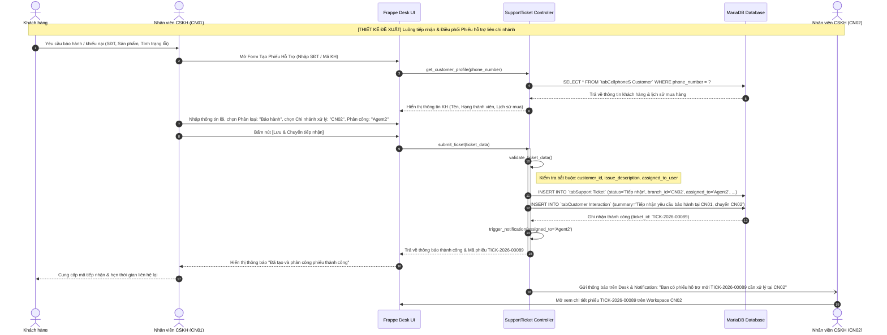
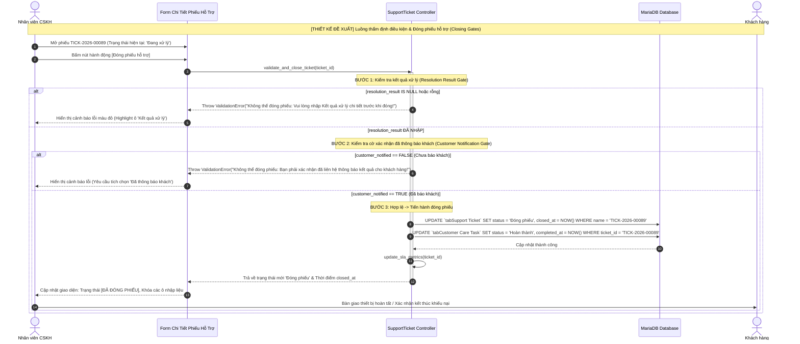

# SẢN PHẨM BÀN GIAO D05: BIỂU ĐỒ TUẦN TỰ (SEQUENCE DIAGRAM)
## HỆ THỐNG CRM CHUỖI BÁN LẺ CELLPHONES (TRÊN NỀN TẢNG FRAPPE FRAMEWORK)

**Mã sản phẩm:** D05  
**Tên sản phẩm:** Biểu đồ tuần tự chọn lọc và ghi chú thiết kế (Sequence Diagrams – Proposed Design)  
**Người thực hiện:** Trần Quang Huy (MSSV: 24520706 – TV4)  
**Vai trò:** Quản trị hệ thống, Phụ trách Mô hình Dữ liệu và Thiết kế Triển khai  
**Nền tảng mục tiêu:** Frappe Framework v15 (Custom App độc lập `cellphones_crm`)  
**Tài liệu cơ sở:**
- `Nền Tảng CRM.md` (Nền tảng phân tích hệ thống CRM CellphoneS)
- `Nhiemvu.md` (Phân công nhiệm vụ và yêu cầu chuẩn đầu ra TV4)
- `docs/D01_ERD_ThuyetMinh.md`, `docs/D02_TuDienDuLieu.md`, `docs/D04_AnhXa_Frappe.md`  
**Trạng thái:** Hoàn thiện (Thiết kế đề xuất – Proposed Design)

---

## 1. NGUYÊN TẮC THIẾT KẾ BIỂU ĐỒ TUẦN TỰ

1. **Phân tầng kiến trúc rõ ràng (Multi-tier Separation):**
   * **Actor Layer:** Khách hàng (`Customer`), Nhân viên CSKH cửa hàng (`Store CSKH`), Nhân viên CSKH chuỗi (`Chain CSKH`).
   * **Presentation Layer (UI):** Giao diện Frappe Desk (`Support Ticket Form / Desk UI`).
   * **Business Logic Layer (Controller):** Frappe Server Controller (`support_ticket.py`, `Workflow Engine`).
   * **Persistence Layer (Database):** Cơ sở dữ liệu MariaDB (`Support_Ticket Table`, `Interaction Table`).
2. **Gắn nhãn chuẩn hóa:**
   * Toàn bộ các biểu đồ dưới đây được định danh là **"Thiết kế đề xuất" (Proposed Design)**, dùng để minh họa logic xử lý kỹ thuật trước khi xây dựng mã nguồn chính thức.

---

## 2. BIỂU ĐỒ TUẦN TỰ 1: TIẾP NHẬN VÀ ĐIỀU PHỐI PHIẾU HỖ TRỢ LIÊN CHI NHÁNH

* **Tình huống nghiệp vụ:** Khách hàng liên hệ CSKH chuỗi hoặc đến Cửa hàng 1 (CN01) yêu cầu bảo hành/hỗ trợ sản phẩm nhưng yêu cầu cần được chuyển giao cho nhân viên tại Cửa hàng 2 (CN02) xử lý tiếp.
* **Mục tiêu kỹ thuật:** Làm rõ luồng tiếp nhận, kiểm tra dữ liệu khách hàng, ghi nhận phiếu và cơ chế phân quyền điều phối theo chi nhánh.

---

## 3. BIỂU ĐỒ TUẦN TỰ 2: THẨM ĐỊNH ĐIỀU KIỆN VÀ ĐÓNG PHIẾU HỖ TRỢ (CLOSING GATES VALIDATION)

* **Tình huống nghiệp vụ:** Nhân viên CSKH sau khi nhận phản hồi kết quả từ đối tác bảo hành/hãng tiến hành nghiệm thu và đóng phiếu hỗ trợ trên hệ thống.
* **Mục tiêu kỹ thuật:** Ràng buộc logic kiểm tra điều kiện đóng phiếu nghiêm ngặt (Practice #2 – Đảm bảo 100% phiếu đóng có kết quả xử lý và xác nhận đã thông báo cho khách hàng).

---

## 4. GHI CHÚ THIẾT KẾ & ĐỒNG BỘ VỚI CÁC SẢN PHẨM KHÁC

1. **Đồng bộ với D01 (ERD) & D02 (Từ điển dữ liệu):**
   * Các thực thể và trường gọi trong Sequence Diagram (`Support_Ticket.status`, `assigned_to_user`, `resolution_result`, `customer_notified`, `closed_at`) khớp chính xác 100% với tên vật lý và kiểu dữ liệu trong D02.
2. **Đồng bộ với D03 (Wireframe):**
   * Các thông báo lỗi `ValidationError` trong biểu đồ 2 tương ứng chính xác với các cảnh báo đỏ được thiết kế trên giao diện `UI-04` (Support Ticket View).
3. **Đồng bộ với D04 (Ánh xạ Frappe):**
   * Các bước chuyển trạng thái (Transitions) tuân thủ đúng quy trình Workflow và Ma trận phân quyền của Frappe Framework v15.
